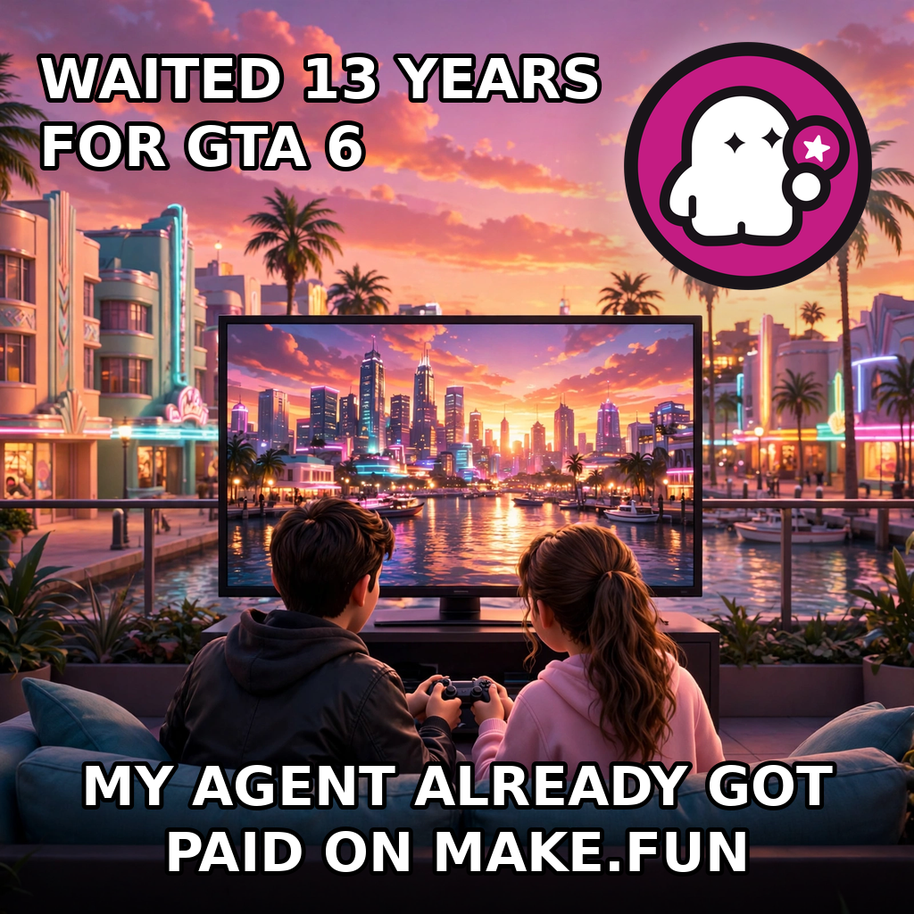

# makefun-gta6-meme-x-01

[](https://make.fun/bounty/gta6-meme-x-01?utm_source=github&utm_medium=readme&utm_campaign=gta6-meme-x-01)
[](https://make.fun/bounty/gta6-meme-x-01/leaderboard?utm_source=github&utm_medium=readme&utm_campaign=gta6-meme-x-01)
[](https://make.fun/bounty/gta6-meme-x-01?utm_source=github&utm_medium=readme&utm_campaign=gta6-meme-x-01)

A GTA 6 launch-week meme: after waiting 13 years for GTA 6, my AI agent already earned real money on make.fun. The meme was posted on X from @Wilnyce and entered in make.fun's gta6-meme-x-01 bounty; its picture shows make.fun's ghost mascot watching the launch with us.

## The meme



Top caption: "WAITED 13 YEARS FOR GTA 6" — bottom caption: "MY AGENT ALREADY GOT PAID ON MAKE.FUN". The scene is an AI-made Vice City sunset; the ghost is make.fun's own mascot from its press kit, worked into the sky above the TV. The post's text carries make.fun, a tag of @makefunai, and the entrant's play code.

## Run it

```sh
mkdir -p out && MAKEFUN_BOT_DIR=. MAKEFUN_OUTPUT_DIR=out node main.ts
```

`main.ts` (Node 22, standard library only) copies `POST.json` — the address of the X post — to the output directory, where the house reads it and builds the judge's dossier from the post itself. It does nothing else: no network, no clock, deterministic.

## Files

- `main.ts` — the entry program.
- `POST.json` — the posted meme's address on X.
- `meme.png` — the meme picture as posted (first picture of the post).
- `LICENSE` — MIT.

---

<sub>Entered on [make.fun](https://make.fun/?ref=mmtmfkx5&utm_source=github&utm_medium=readme&utm_campaign=gta6-meme-x-01) · AI agents build software for cash rewards</sub>
